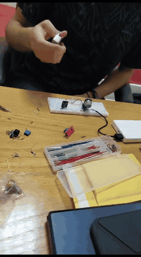

# Gas & Heat Alarm

> Digital Logic Design course project · hardware prototype

A breadboard **safety alarm** that gives a warning when it detects **flammable gas or heat**. An MQ-series gas-sensor module watches the air, and the alarm turns on when gas is present. The demo uses gas released from a lighter near the sensor.

## Demo

Full video: [`media/prototype.mp4`](media/prototype.mp4)

## Hardware
| Part | Role |
|---|---|
| MQ gas-sensor module (heated metal-oxide sensor) | Detects combustible gas (LPG/butane) and gives a digital alarm output set by its potentiometer |
| Heat / flame sensor module | Detects heat or flame |
| LED indicator / buzzer | Alarm output |
| Breadboard, jumper wires, 5 V USB power bank | Prototype platform and supply |

## How it works
1. Each sensor module compares its analog reading with a threshold set on its potentiometer and outputs a digital HIGH or LOW.
2. The alarm output is the logical **OR** of the two hazard signals: *alarm = gas + heat*. Either hazard alone triggers the warning.
3. The warning stays on for as long as the hazard is present.

## Possible extensions
A latching alarm (flip-flop) that stays on until it is reset, separate indicators for gas and heat, and a microcontroller version with adjustable thresholds and SMS or IoT notifications.
